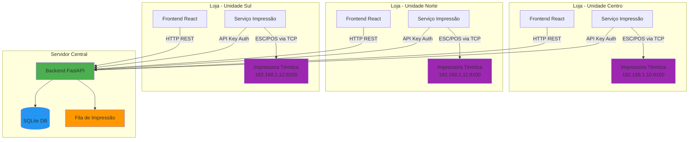
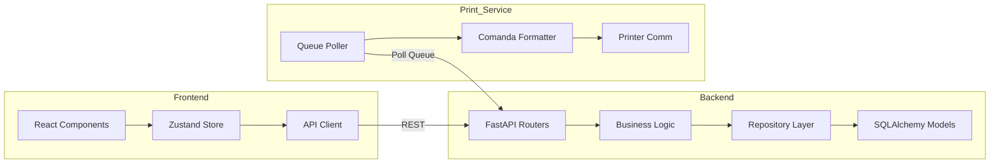
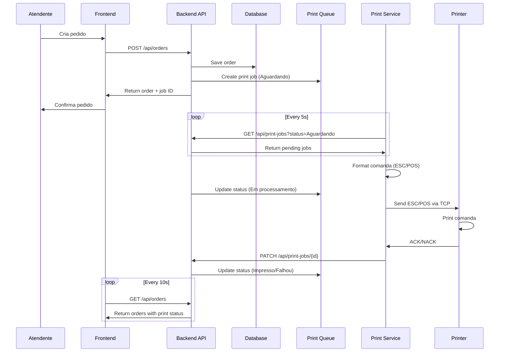

# Design Document

## Overview

O Sistema de Gestão de Pastelaria é uma aplicação full-stack desenvolvida para gerenciar pedidos, acompanhar preparação em modelo Kanban e imprimir comandas físicas em impressoras térmicas. O sistema serve três unidades físicas (Centro, Norte, Sul) e implementa um fluxo completo desde o registro do pedido até a impressão na cozinha.

### Principais Características

- **Frontend React/TypeScript**: Interface responsiva com dashboard, visualização Kanban e gestão de pedidos
- **Backend FastAPI**: API REST com persistência SQLite e gerenciamento de fila de impressão
- **Serviço de Impressão Local**: Script Python autônomo que processa fila e comunica com impressoras via Ethernet
- **Impressão Física**: Suporte a impressoras térmicas ESC/POS (Elgin/Bematech i9 Full 2) via protocolo Ethernet
- **Dual Mode**: Modo demonstração (preview visual) e modo real (impressão física)
- **Multi-Unidade**: Separação lógica e física por unidade com roteamento de impressão

### Fluxo Principal

1. Atendente registra pedido no Frontend
2. Backend persiste pedido e cria trabalho de impressão na fila
3. Serviço de Impressão local consulta fila periodicamente
4. Serviço formata comanda em ESC/POS e envia para impressora via socket TCP/IP
5. Impressora térmica imprime comanda física
6. Serviço notifica Backend sobre sucesso/falha
7. Frontend atualiza status via polling

## Architecture

### High-Level Architecture



### Component Architecture



### Data Flow - Order Creation to Print



## Components and Interfaces

### Backend API Endpoints

#### Orders

```
POST   /api/orders                    # Create new order
GET    /api/orders                    # List orders (with filters)
GET    /api/orders/{id}               # Get order details
PATCH  /api/orders/{id}/status        # Update order status
GET    /api/orders/stats              # Get order statistics
```

#### Print Jobs

```
GET    /api/print-jobs                # List print jobs (requires API key)
GET    /api/print-jobs/{id}           # Get print job details
PATCH  /api/print-jobs/{id}           # Update print job status
POST   /api/print-jobs/{id}/reprint   # Create reprint job
```

#### Units

```
GET    /api/units                     # List units
GET    /api/units/{id}                # Get unit details
POST   /api/units                     # Create unit (admin)
PATCH  /api/units/{id}                # Update unit
```

#### Products

```
GET    /api/products                  # List products
GET    /api/products/{id}             # Get product details
POST   /api/products                  # Create product (admin)
PATCH  /api/products/{id}             # Update product
DELETE /api/products/{id}             # Delete product
```

#### Printers

```
GET    /api/printers                  # List printers
GET    /api/printers/{id}             # Get printer details
POST   /api/printers                  # Register printer
PATCH  /api/printers/{id}             # Update printer config
POST   /api/printers/{id}/test        # Test printer connection
```

#### API Keys

```
POST   /api/api-keys                  # Generate new API key
GET    /api/api-keys                  # List API keys (masked)
DELETE /api/api-keys/{id}             # Revoke API key
```

### Pydantic Models

#### Request Models

```python
class OrderCreate(BaseModel):
    unit_id: int
    customer_name: str
    service_type: Literal["Balcão", "Retirada", "Entrega"]
    items: List[OrderItem]
    observations: Optional[str] = None
    payment_method: str
    delivery_fee: Decimal = Decimal("0.00")
    discount: Decimal = Decimal("0.00")

class OrderItem(BaseModel):
    product_id: int
    quantity: int
    extras: List[int] = []  # Extra IDs
    item_observations: Optional[str] = None

class OrderStatusUpdate(BaseModel):
    status: Literal["Recebido", "Em preparação", "Pronto", "Entregue"]

class PrintJobUpdate(BaseModel):
    status: Literal["Em processamento", "Impresso", "Falhou"]
    error_message: Optional[str] = None
    printed_at: Optional[datetime] = None
```

#### Response Models

```python
class OrderResponse(BaseModel):
    id: int
    order_number: str
    unit: UnitResponse
    customer_name: str
    service_type: str
    items: List[OrderItemResponse]
    total_amount: Decimal
    status: str
    payment_method: str
    created_at: datetime
    print_job: Optional[PrintJobResponse] = None

class PrintJobResponse(BaseModel):
    id: str  # UUID
    order_id: int
    unit_id: int
    status: str
    is_reprint: bool
    created_at: datetime
    processed_at: Optional[datetime] = None
    error_message: Optional[str] = None
```

### Frontend Components Structure

```
src/
├── components/
│   ├── Dashboard/
│   │   ├── Dashboard.tsx
│   │   ├── SalesCard.tsx
│   │   ├── OrderStatusCard.tsx
│   │   └── UnitRevenueCard.tsx
│   ├── Orders/
│   │   ├── OrderBoard.tsx         # Kanban board
│   │   ├── OrderColumn.tsx        # Kanban column
│   │   ├── OrderCard.tsx          # Order card
│   │   ├── OrderForm.tsx          # Create/edit order
│   │   ├── OrderDetails.tsx       # Order modal
│   │   └── OrderFilters.tsx
│   ├── Products/
│   │   ├── ProductList.tsx
│   │   ├── ProductForm.tsx
│   │   └── ProductCard.tsx
│   ├── Printers/
│   │   ├── PrinterConfig.tsx
│   │   ├── PrinterStatus.tsx
│   │   └── PrinterTest.tsx
│   ├── Reports/
│   │   ├── ReportsPage.tsx
│   │   ├── SalesReport.tsx
│   │   └── ReportFilters.tsx
│   └── common/
│       ├── Sidebar.tsx
│       ├── Header.tsx
│       └── Loading.tsx
├── store/
│   ├── ordersStore.ts
│   ├── productsStore.ts
│   ├── unitsStore.ts
│   └── printersStore.ts
├── services/
│   ├── api.ts                     # Axios instance
│   ├── ordersService.ts
│   ├── productsService.ts
│   └── printersService.ts
├── types/
│   ├── order.ts
│   ├── product.ts
│   └── printer.ts
├── utils/
│   ├── formatters.ts
│   └── validators.ts
└── App.tsx
```

### Backend Directory Structure

```
backend/
├── app/
│   ├── main.py                    # FastAPI app initialization
│   ├── config.py                  # Configuration settings
│   ├── database.py                # Database connection
│   ├── models/
│   │   ├── __init__.py
│   │   ├── order.py               # Order model
│   │   ├── product.py             # Product model
│   │   ├── unit.py                # Unit model
│   │   ├── printer.py             # Printer model
│   │   ├── print_job.py           # Print job model
│   │   └── api_key.py             # API key model
│   ├── schemas/
│   │   ├── __init__.py
│   │   ├── order.py               # Order Pydantic schemas
│   │   ├── product.py
│   │   ├── unit.py
│   │   ├── printer.py
│   │   └── print_job.py
│   ├── routers/
│   │   ├── __init__.py
│   │   ├── orders.py
│   │   ├── products.py
│   │   ├── units.py
│   │   ├── printers.py
│   │   ├── print_jobs.py
│   │   └── api_keys.py
│   ├── services/
│   │   ├── __init__.py
│   │   ├── order_service.py       # Business logic
│   │   ├── print_queue_service.py
│   │   ├── calculation_service.py
│   │   └── auth_service.py
│   ├── repositories/
│   │   ├── __init__.py
│   │   ├── order_repository.py
│   │   ├── print_job_repository.py
│   │   └── api_key_repository.py
│   ├── middleware/
│   │   ├── __init__.py
│   │   └── auth_middleware.py
│   └── utils/
│       ├── __init__.py
│       ├── comanda_parser.py      # Parse order -> comanda
│       └── comanda_printer.py     # Format comanda -> text
├── scripts/
│   ├── seed_demo_data.py          # Seed demonstration data
│   └── create_api_key.py          # Generate API keys
├── tests/
│   ├── test_orders.py
│   ├── test_print_queue.py
│   ├── test_comanda_parser.py
│   └── test_calculation.py
├── requirements.txt
└── alembic/                       # Future migrations
```

### Print Service Structure

```
print-service/
├── main.py                        # Entry point
├── config.py                      # Configuration
├── poller.py                      # Queue polling
├── formatter.py                   # ESC/POS formatter
├── printer.py                     # Printer communication
├── retry.py                       # Retry logic
├── logger.py                      # Logging setup
├── requirements.txt
└── .env.example
```

## Data Models

### Database Schema

```mermaid
erDiagram
    Unit ||--o{ Order : has
    Unit ||--o| Printer : has
    Order ||--o{ OrderItem : contains
    Order ||--|| PrintJob : generates
    Product ||--o{ OrderItem : "ordered in"
    Product }o--o{ Extra : "can have"
    OrderItem }o--o{ Extra : includes
    
    Unit {
        int id PK
        string name UK
        string location
        boolean is_active
        datetime created_at
    }
    
    Order {
        int id PK
        string order_number UK
        int unit_id FK
        string customer_name
        string service_type
        string status
        string payment_method
        decimal delivery_fee
        decimal discount
        decimal total_amount
        string observations
        datetime created_at
        datetime updated_at
    }
    
    OrderItem {
        int id PK
        int order_id FK
        int product_id FK
        int quantity
        decimal unit_price
        decimal subtotal
        string item_observations
    }
    
    OrderItemExtra {
        int order_item_id FK
        int extra_id FK
    }
    
    Product {
        int id PK
        string name
        string description
        string category
        decimal price
        boolean available
        boolean is_demo
        datetime created_at
    }
    
    Extra {
        int id PK
        string name
        decimal price
        string category
        boolean available
    }
    
    PrintJob {
        string id PK "UUID"
        int order_id FK UK
        int unit_id FK
        string status
        boolean is_reprint
        int reprint_requested_by
        string error_message
        int retry_count
        datetime created_at
        datetime processed_at
        datetime printed_at
    }
    
    Printer {
        int id PK
        int unit_id FK UK
        string name
        string ip_address
        int port
        int paper_width
        string connection_mode
        boolean is_active
        datetime last_print_at
        datetime created_at
    }
    
    ApiKey {
        int id PK
        string key_hash UK
        string name
        boolean is_active
        datetime created_at
        datetime revoked_at
    }
```

### SQLAlchemy Models

#### Order Model

```python
class Order(Base):
    __tablename__ = "orders"
    
    id = Column(Integer, primary_key=True, index=True)
    order_number = Column(String(20), unique=True, nullable=False, index=True)
    unit_id = Column(Integer, ForeignKey("units.id"), nullable=False)
    customer_name = Column(String(200), nullable=False)
    service_type = Column(String(20), nullable=False)  # Balcão, Retirada, Entrega
    status = Column(String(20), default="Recebido", index=True)
    payment_method = Column(String(50), nullable=False)
    delivery_fee = Column(Numeric(10, 2), default=0.00)
    discount = Column(Numeric(10, 2), default=0.00)
    total_amount = Column(Numeric(10, 2), nullable=False)
    observations = Column(Text, nullable=True)
    created_at = Column(DateTime, default=datetime.utcnow, index=True)
    updated_at = Column(DateTime, default=datetime.utcnow, onupdate=datetime.utcnow)
    
    # Relationships
    unit = relationship("Unit", back_populates="orders")
    items = relationship("OrderItem", back_populates="order", cascade="all, delete-orphan")
    print_job = relationship("PrintJob", back_populates="order", uselist=False)
    
    __table_args__ = (
        Index('idx_unit_status', 'unit_id', 'status'),
        Index('idx_created_at', 'created_at'),
    )
```

#### PrintJob Model

```python
class PrintJob(Base):
    __tablename__ = "print_jobs"
    
    id = Column(String(36), primary_key=True, default=lambda: str(uuid.uuid4()))
    order_id = Column(Integer, ForeignKey("orders.id"), unique=True, nullable=False, index=True)
    unit_id = Column(Integer, ForeignKey("units.id"), nullable=False, index=True)
    status = Column(String(20), default="Aguardando", index=True)
    is_reprint = Column(Boolean, default=False)
    reprint_requested_by = Column(Integer, nullable=True)
    error_message = Column(Text, nullable=True)
    retry_count = Column(Integer, default=0)
    created_at = Column(DateTime, default=datetime.utcnow)
    processed_at = Column(DateTime, nullable=True)
    printed_at = Column(DateTime, nullable=True)
    
    # Relationships
    order = relationship("Order", back_populates="print_job")
    unit = relationship("Unit")
    
    __table_args__ = (
        Index('idx_status_unit', 'status', 'unit_id'),
        Index('idx_created_at', 'created_at'),
    )
```

### Key Indexes

- `orders.order_number`: Unique index for fast lookup
- `orders.unit_id + status`: Composite index for Kanban filtering
- `orders.created_at`: Index for time-based queries
- `print_jobs.status + unit_id`: Composite index for queue polling
- `print_jobs.order_id`: Unique index to prevent duplicates

## Core Business Logic

### Order Total Calculation

```python
class CalculationService:
    @staticmethod
    def calculate_order_total(
        items: List[OrderItem],
        delivery_fee: Decimal,
        discount: Decimal
    ) -> Decimal:
        """
        Calculate total order amount.
        
        Formula: (sum of item subtotals + delivery fee) - discount
        """
        items_total = sum(item.subtotal for item in items)
        total = items_total + delivery_fee - discount
        return max(total, Decimal("0.00"))
    
    @staticmethod
    def calculate_item_subtotal(
        product_price: Decimal,
        extras: List[Extra],
        quantity: int
    ) -> Decimal:
        """
        Calculate subtotal for an order item.
        
        Formula: (product price + sum of extra prices) * quantity
        """
        extras_total = sum(extra.price for extra in extras)
        unit_total = product_price + extras_total
        return unit_total * quantity
```

### Print Queue Service

```python
class PrintQueueService:
    def __init__(self, session: Session):
        self.session = session
    
    async def create_print_job(self, order_id: int, unit_id: int) -> PrintJob:
        """
        Create a new print job for an order.
        Prevents duplicates by checking existing jobs.
        """
        # Check for existing non-failed job
        existing = self.session.query(PrintJob).filter(
            PrintJob.order_id == order_id,
            PrintJob.status.in_(["Aguardando", "Em processamento", "Impresso"])
        ).first()
        
        if existing:
            raise ValueError(f"Print job already exists for order {order_id}")
        
        job = PrintJob(
            order_id=order_id,
            unit_id=unit_id,
            status="Aguardando"
        )
        self.session.add(job)
        self.session.commit()
        return job
    
    async def get_pending_jobs(self, unit_id: int, limit: int = 10) -> List[PrintJob]:
        """
        Get pending print jobs for a specific unit.
        Atomically updates status to prevent duplicate processing.
        """
        jobs = self.session.query(PrintJob).filter(
            PrintJob.unit_id == unit_id,
            PrintJob.status == "Aguardando"
        ).order_by(PrintJob.created_at).limit(limit).with_for_update(skip_locked=True).all()
        
        # Update status atomically
        for job in jobs:
            job.status = "Em processamento"
            job.processed_at = datetime.utcnow()
        
        self.session.commit()
        return jobs
    
    async def mark_as_printed(self, job_id: str) -> PrintJob:
        """Mark print job as successfully printed."""
        job = self.session.query(PrintJob).filter(PrintJob.id == job_id).first()
        if not job:
            raise ValueError(f"Print job {job_id} not found")
        
        job.status = "Impresso"
        job.printed_at = datetime.utcnow()
        self.session.commit()
        return job
    
    async def mark_as_failed(self, job_id: str, error_message: str) -> PrintJob:
        """Mark print job as failed with error details."""
        job = self.session.query(PrintJob).filter(PrintJob.id == job_id).first()
        if not job:
            raise ValueError(f"Print job {job_id} not found")
        
        job.status = "Falhou"
        job.error_message = error_message
        job.retry_count += 1
        self.session.commit()
        return job
    
    async def create_reprint_job(
        self,
        order_id: int,
        requested_by: int
    ) -> PrintJob:
        """Create a reprint job for an existing order."""
        order = self.session.query(Order).filter(Order.id == order_id).first()
        if not order:
            raise ValueError(f"Order {order_id} not found")
        
        job = PrintJob(
            order_id=order_id,
            unit_id=order.unit_id,
            status="Aguardando",
            is_reprint=True,
            reprint_requested_by=requested_by
        )
        self.session.add(job)
        self.session.commit()
        return job
```

## Parser and Pretty Printer

### Comanda Data Structure

```python
@dataclass
class ComandaHeader:
    store_name: str = "PASTELARIA"
    order_number: str
    unit_name: str
    date: str
    time: str
    service_type: str
    customer_name: str

@dataclass
class ComandaItem:
    quantity: int
    product_name: str
    unit_price: Decimal
    extras: List[str]
    observations: Optional[str]
    subtotal: Decimal

@dataclass
class ComandaFooter:
    payment_method: str
    subtotal: Decimal
    delivery_fee: Decimal
    discount: Decimal
    total: Decimal
    observations: Optional[str]

@dataclass
class Comanda:
    header: ComandaHeader
    items: List[ComandaItem]
    footer: ComandaFooter
    is_reprint: bool = False
```

### Parser Implementation

```python
class ComandaParser:
    """Parse Order model into Comanda structure."""
    
    @staticmethod
    def parse(order: Order) -> Comanda:
        """
        Convert database Order into Comanda structure.
        
        Args:
            order: Order model with relationships loaded
            
        Returns:
            Comanda structure ready for formatting
            
        Raises:
            ValueError: If order data is invalid or incomplete
        """
        if not order.unit:
            raise ValueError("Order must have unit relationship loaded")
        
        if not order.items:
            raise ValueError("Order must have at least one item")
        
        # Parse header
        header = ComandaHeader(
            order_number=order.order_number,
            unit_name=order.unit.name,
            date=order.created_at.strftime("%d/%m/%Y"),
            time=order.created_at.strftime("%H:%M"),
            service_type=order.service_type,
            customer_name=order.customer_name
        )
        
        # Parse items
        items = []
        for order_item in order.items:
            extras = [extra.name for extra in order_item.extras]
            
            comanda_item = ComandaItem(
                quantity=order_item.quantity,
                product_name=order_item.product.name,
                unit_price=order_item.unit_price,
                extras=extras,
                observations=order_item.item_observations,
                subtotal=order_item.subtotal
            )
            items.append(comanda_item)
        
        # Parse footer
        footer = ComandaFooter(
            payment_method=order.payment_method,
            subtotal=order.total_amount + order.discount - order.delivery_fee,
            delivery_fee=order.delivery_fee,
            discount=order.discount,
            total=order.total_amount,
            observations=order.observations
        )
        
        # Check if reprint
        is_reprint = order.print_job and order.print_job.is_reprint
        
        return Comanda(
            header=header,
            items=items,
            footer=footer,
            is_reprint=is_reprint
        )
```

### Pretty Printer Implementation

```python
class ComandaPrinter:
    """Format Comanda structure into printable text."""
    
    def __init__(self, paper_width: int = 32):
        """
        Initialize printer with paper width.
        
        Args:
            paper_width: Characters per line (32 for 58mm, 48 for 80mm)
        """
        self.width = paper_width
    
    def format(self, comanda: Comanda) -> str:
        """
        Format Comanda into text for thermal printer.
        
        Args:
            comanda: Comanda structure
            
        Returns:
            Formatted text string ready for printing
        """
        lines = []
        
        # Reprint marker
        if comanda.is_reprint:
            lines.append(self._center("*** SEGUNDA VIA ***"))
            lines.append("")
        
        # Header
        lines.append(self._center(comanda.header.store_name))
        lines.append(self._center(f"Unidade {comanda.header.unit_name}"))
        lines.append(self._separator())
        lines.append(self._center(f"PEDIDO #{comanda.header.order_number}"))
        lines.append(self._separator())
        lines.append(f"Data: {comanda.header.date}  Hora: {comanda.header.time}")
        lines.append(f"Cliente: {comanda.header.customer_name}")
        lines.append(f"Tipo: {comanda.header.service_type}")
        lines.append(self._separator())
        
        # Items
        for item in comanda.items:
            lines.append(f"{item.quantity}x {item.product_name}")
            
            if item.extras:
                for extra in item.extras:
                    lines.append(f"   + {extra}")
            
            if item.observations:
                lines.append(f"   Obs: {item.observations}")
            
            lines.append(self._right_align(f"R$ {item.subtotal:.2f}"))
            lines.append("")
        
        # Kitchen observations
        if comanda.footer.observations:
            lines.append(self._separator())
            lines.append("OBSERVAÇÕES PARA COZINHA:")
            lines.append(comanda.footer.observations)
            lines.append(self._separator())
        
        # Footer
        lines.append(self._separator())
        lines.append(self._justify("Subtotal:", f"R$ {comanda.footer.subtotal:.2f}"))
        
        if comanda.footer.delivery_fee > 0:
            lines.append(self._justify("Taxa entrega:", f"R$ {comanda.footer.delivery_fee:.2f}"))
        
        if comanda.footer.discount > 0:
            lines.append(self._justify("Desconto:", f"R$ {comanda.footer.discount:.2f}"))
        
        lines.append(self._separator())
        lines.append(self._justify("TOTAL:", f"R$ {comanda.footer.total:.2f}"))
        lines.append(self._separator())
        lines.append(f"Pagamento: {comanda.footer.payment_method}")
        lines.append("")
        lines.append(self._center("Obrigado!"))
        lines.append("")
        lines.append("")
        
        return "\n".join(lines)
    
    def _center(self, text: str) -> str:
        """Center text within paper width."""
        return text.center(self.width)
    
    def _separator(self) -> str:
        """Generate separator line."""
        return "-" * self.width
    
    def _right_align(self, text: str) -> str:
        """Right align text."""
        return text.rjust(self.width)
    
    def _justify(self, left: str, right: str) -> str:
        """Justify text with left and right parts."""
        space = self.width - len(left) - len(right)
        return left + " " * max(1, space) + right
```

### Round-Trip Property

The Parser and Pretty Printer satisfy the following property:

**Property**: For any valid Comanda structure `C`, parsing and then printing should preserve semantic equivalence:

```python
def test_round_trip_property(comanda: Comanda):
    """
    Property: Semantic information is preserved through round-trip.
    
    Note: We cannot do text round-trip (text -> parse -> text) because
    the printer adds formatting. Instead, we verify structural round-trip:
    Comanda -> text -> visual verification that all data is present.
    """
    text = printer.format(comanda)
    
    # Verify all essential information is present in text
    assert comanda.header.order_number in text
    assert comanda.header.customer_name in text
    assert comanda.header.unit_name in text
    
    for item in comanda.items:
        assert item.product_name in text
        assert f"{item.quantity}x" in text
        for extra in item.extras:
            assert extra in text
    
    assert f"R$ {comanda.footer.total:.2f}" in text
    assert comanda.footer.payment_method in text
```

## Print Service Implementation

### Main Print Service

```python
class PrintService:
    """Main print service that polls queue and prints comandas."""
    
    def __init__(self, config: PrintConfig):
        self.config = config
        self.api_client = APIClient(config.backend_url, config.api_key)
        self.formatter = ESCPOSFormatter()
        self.printer_comm = PrinterCommunication(
            config.printer_ip,
            config.printer_port
        )
        self.logger = setup_logger("print_service")
        self.retry_handler = RetryHandler()
    
    async def run(self):
        """Main service loop."""
        self.logger.info("Print service started")
        self.logger.info(f"Unit: {self.config.unit_name}")
        self.logger.info(f"Printer: {self.config.printer_ip}:{self.config.printer_port}")
        
        while True:
            try:
                await self._process_queue()
                await asyncio.sleep(self.config.poll_interval)
            except KeyboardInterrupt:
                self.logger.info("Shutting down...")
                break
            except Exception as e:
                self.logger.error(f"Unexpected error: {e}")
                await asyncio.sleep(5)
    
    async def _process_queue(self):
        """Poll queue and process pending jobs."""
        try:
            # Fetch pending jobs for this unit
            jobs = await self.api_client.get_pending_print_jobs(
                self.config.unit_id
            )
            
            if not jobs:
                return
            
            self.logger.info(f"Found {len(jobs)} pending job(s)")
            
            for job in jobs:
                await self._process_job(job)
        
        except APIError as e:
            self.logger.error(f"API error: {e}")
    
    async def _process_job(self, job: PrintJob):
        """Process a single print job."""
        try:
            self.logger.info(f"Processing job {job.id} for order {job.order_id}")
            
            # Get full order details
            order = await self.api_client.get_order(job.order_id)
            
            # Parse order to comanda
            comanda = ComandaParser.parse(order)
            
            # Format comanda to text
            text = ComandaPrinter(self.config.paper_width).format(comanda)
            
            # Convert to ESC/POS
            escpos_data = self.formatter.format(text, job.is_reprint)
            
            # Send to printer
            success = await self.printer_comm.print(escpos_data)
            
            if success:
                # Notify backend
                await self.api_client.mark_job_printed(job.id)
                self.logger.info(f"Job {job.id} printed successfully")
            else:
                raise PrinterError("Printer communication failed")
        
        except Exception as e:
            self.logger.error(f"Job {job.id} failed: {e}")
            
            # Determine if should retry
            should_retry = self.retry_handler.should_retry(job.retry_count)
            
            if should_retry:
                retry_delay = self.retry_handler.get_delay(job.retry_count)
                self.logger.info(f"Will retry in {retry_delay}s")
                # Job remains "Em processamento" and will be picked up again
            else:
                # Mark as failed
                await self.api_client.mark_job_failed(job.id, str(e))
                self.logger.error(f"Job {job.id} permanently failed")
```

### ESC/POS Formatter

```python
class ESCPOSFormatter:
    """Format text and commands for ESC/POS thermal printers."""
    
    # ESC/POS Control Codes
    ESC = b'\x1b'
    GS = b'\x1d'
    
    # Initialization
    INIT = ESC + b'@'
    
    # Text formatting
    BOLD_ON = ESC + b'E\x01'
    BOLD_OFF = ESC + b'E\x00'
    DOUBLE_HEIGHT = ESC + b'!\x10'
    NORMAL_SIZE = ESC + b'!\x00'
    
    # Alignment
    ALIGN_LEFT = ESC + b'a\x00'
    ALIGN_CENTER = ESC + b'a\x01'
    ALIGN_RIGHT = ESC + b'a\x02'
    
    # Line feed
    LF = b'\n'
    
    # Paper cut
    CUT_FULL = GS + b'V\x00'
    CUT_PARTIAL = GS + b'V\x01'
    
    def format(self, text: str, is_reprint: bool = False) -> bytes:
        """
        Convert formatted text to ESC/POS byte sequence.
        
        Args:
            text: Formatted text from ComandaPrinter
            is_reprint: Whether this is a reprint (affects header)
            
        Returns:
            ESC/POS byte sequence ready to send to printer
        """
        commands = []
        
        # Initialize printer
        commands.append(self.INIT)
        
        # Encode text (Code Page 850 for Portuguese)
        encoded_text = text.encode('cp850', errors='replace')
        
        # Add text
        commands.append(self.ALIGN_LEFT)
        commands.append(encoded_text)
        
        # Feed and cut
        commands.append(self.LF * 3)
        commands.append(self.CUT_PARTIAL)
        
        return b''.join(commands)
    
    def format_header(self, header_text: str, is_reprint: bool) -> bytes:
        """Format header with special styling."""
        commands = []
        
        if is_reprint:
            commands.append(self.ALIGN_CENTER)
            commands.append(self.BOLD_ON)
            commands.append(self.DOUBLE_HEIGHT)
            commands.append("*** SEGUNDA VIA ***".encode('cp850'))
            commands.append(self.NORMAL_SIZE)
            commands.append(self.BOLD_OFF)
            commands.append(self.LF * 2)
        
        commands.append(self.ALIGN_CENTER)
        commands.append(self.BOLD_ON)
        commands.append(header_text.encode('cp850'))
        commands.append(self.BOLD_OFF)
        commands.append(self.ALIGN_LEFT)
        
        return b''.join(commands)
```

### Printer Communication

```python
class PrinterCommunication:
    """Handle TCP/IP communication with thermal printer."""
    
    def __init__(self, ip: str, port: int, timeout: int = 10):
        self.ip = ip
        self.port = port
        self.timeout = timeout
        self.logger = logging.getLogger("printer_comm")
    
    async def print(self, data: bytes) -> bool:
        """
        Send ESC/POS data to printer via TCP socket.
        
        Args:
            data: ESC/POS byte sequence
            
        Returns:
            True if successful, False otherwise
        """
        try:
            reader, writer = await asyncio.wait_for(
                asyncio.open_connection(self.ip, self.port),
                timeout=self.timeout
            )
            
            self.logger.debug(f"Connected to {self.ip}:{self.port}")
            
            # Send data
            writer.write(data)
            await writer.drain()
            
            self.logger.debug(f"Sent {len(data)} bytes")
            
            # Wait a bit for printer to process
            await asyncio.sleep(0.5)
            
            # Close connection
            writer.close()
            await writer.wait_closed()
            
            self.logger.info("Print successful")
            return True
        
        except asyncio.TimeoutError:
            self.logger.error(f"Connection timeout to {self.ip}:{self.port}")
            return False
        
        except ConnectionRefusedError:
            self.logger.error(f"Connection refused by {self.ip}:{self.port}")
            return False
        
        except Exception as e:
            self.logger.error(f"Print error: {e}")
            return False
    
    async def test_connection(self) -> bool:
        """Test printer connectivity."""
        try:
            reader, writer = await asyncio.wait_for(
                asyncio.open_connection(self.ip, self.port),
                timeout=5
            )
            writer.close()
            await writer.wait_closed()
            return True
        except Exception:
            return False
```

### Retry Handler

```python
class RetryHandler:
    """Handle retry logic with exponential backoff."""
    
    MAX_RETRIES = 5
    BASE_DELAY = 5  # seconds
    MAX_DELAY = 300  # 5 minutes
    
    def should_retry(self, retry_count: int) -> bool:
        """Determine if job should be retried."""
        return retry_count < self.MAX_RETRIES
    
    def get_delay(self, retry_count: int) -> int:
        """Calculate exponential backoff delay."""
        delay = self.BASE_DELAY * (2 ** retry_count)
        return min(delay, self.MAX_DELAY)
```

## Frontend State Management

### Orders Store (Zustand)

```typescript
interface OrdersStore {
  orders: Order[];
  loading: boolean;
  error: string | null;
  
  // Actions
  fetchOrders: (filters?: OrderFilters) => Promise<void>;
  createOrder: (order: OrderCreate) => Promise<Order>;
  updateOrderStatus: (id: number, status: OrderStatus) => Promise<void>;
  
  // Polling
  startPolling: (interval?: number) => void;
  stopPolling: () => void;
}

const useOrdersStore = create<OrdersStore>((set, get) => ({
  orders: [],
  loading: false,
  error: null,
  pollingInterval: null,
  
  fetchOrders: async (filters) => {
    set({ loading: true, error: null });
    try {
      const orders = await ordersService.getOrders(filters);
      set({ orders, loading: false });
    } catch (error) {
      set({ error: error.message, loading: false });
    }
  },
  
  createOrder: async (orderData) => {
    const order = await ordersService.createOrder(orderData);
    set((state) => ({
      orders: [...state.orders, order]
    }));
    return order;
  },
  
  updateOrderStatus: async (id, status) => {
    await ordersService.updateOrderStatus(id, status);
    set((state) => ({
      orders: state.orders.map(o =>
        o.id === id ? { ...o, status } : o
      )
    }));
  },
  
  startPolling: (interval = 10000) => {
    const { fetchOrders, stopPolling } = get();
    stopPolling(); // Clear any existing interval
    
    const id = setInterval(() => {
      fetchOrders();
    }, interval);
    
    set({ pollingInterval: id });
  },
  
  stopPolling: () => {
    const { pollingInterval } = get();
    if (pollingInterval) {
      clearInterval(pollingInterval);
      set({ pollingInterval: null });
    }
  }
}));
```

## Security Implementation

### API Key Generation and Storage

```python
import secrets
import hashlib
from datetime import datetime

class APIKeyService:
    """Manage API key generation and validation."""
    
    @staticmethod
    def generate_key() -> str:
        """Generate a secure random API key."""
        return secrets.token_urlsafe(32)
    
    @staticmethod
    def hash_key(key: str) -> str:
        """Hash API key for secure storage."""
        return hashlib.sha256(key.encode()).hexdigest()
    
    def create_api_key(self, name: str, session: Session) -> tuple[str, APIKey]:
        """
        Create new API key.
        
        Returns:
            Tuple of (plain_key, api_key_model)
            Plain key is shown once, hash is stored
        """
        plain_key = self.generate_key()
        key_hash = self.hash_key(plain_key)
        
        api_key = APIKey(
            key_hash=key_hash,
            name=name,
            is_active=True,
            created_at=datetime.utcnow()
        )
        
        session.add(api_key)
        session.commit()
        
        return plain_key, api_key
    
    def validate_key(self, plain_key: str, session: Session) -> bool:
        """Validate API key against stored hash."""
        key_hash = self.hash_key(plain_key)
        
        api_key = session.query(APIKey).filter(
            APIKey.key_hash == key_hash,
            APIKey.is_active == True,
            APIKey.revoked_at.is_(None)
        ).first()
        
        return api_key is not None
```

### Authentication Middleware

```python
from fastapi import Security, HTTPException, status
from fastapi.security import HTTPBearer, HTTPAuthorizationCredentials

security = HTTPBearer()

async def verify_api_key(
    credentials: HTTPAuthorizationCredentials = Security(security),
    session: Session = Depends(get_db)
) -> bool:
    """
    Dependency to verify API key in Authorization header.
    
    Usage:
        @router.get("/protected", dependencies=[Depends(verify_api_key)])
    """
    if not credentials:
        raise HTTPException(
            status_code=status.HTTP_401_UNAUTHORIZED,
            detail="Missing API key"
        )
    
    api_key_service = APIKeyService()
    is_valid = api_key_service.validate_key(credentials.credentials, session)
    
    if not is_valid:
        raise HTTPException(
            status_code=status.HTTP_401_UNAUTHORIZED,
            detail="Invalid or revoked API key"
        )
    
    return True
```

## Error Handling

### Backend Error Handling

```python
from fastapi import HTTPException, status
from typing import Optional

class OrderNotFoundError(Exception):
    """Raised when order is not found."""
    pass

class DuplicatePrintJobError(Exception):
    """Raised when attempting to create duplicate print job."""
    pass

class PrinterNotConfiguredError(Exception):
    """Raised when unit has no configured printer."""
    pass

@app.exception_handler(OrderNotFoundError)
async def order_not_found_handler(request, exc):
    return JSONResponse(
        status_code=status.HTTP_404_NOT_FOUND,
        content={"detail": "Order not found"}
    )

@app.exception_handler(DuplicatePrintJobError)
async def duplicate_print_job_handler(request, exc):
    return JSONResponse(
        status_code=status.HTTP_409_CONFLICT,
        content={"detail": "Print job already exists for this order"}
    )

@app.exception_handler(ValidationError)
async def validation_error_handler(request, exc):
    return JSONResponse(
        status_code=status.HTTP_422_UNPROCESSABLE_ENTITY,
        content={"detail": exc.errors()}
    )
```

### Frontend Error Handling

```typescript
class APIError extends Error {
  constructor(
    message: string,
    public status: number,
    public code?: string
  ) {
    super(message);
    this.name = 'APIError';
  }
}

async function handleAPIError(error: any): Promise<never> {
  if (error.response) {
    const { status, data } = error.response;
    throw new APIError(
      data.detail || 'An error occurred',
      status,
      data.code
    );
  }
  throw new APIError('Network error', 0);
}

// Usage in components
try {
  await createOrder(orderData);
  toast.success('Pedido criado com sucesso!');
} catch (error) {
  if (error instanceof APIError) {
    if (error.status === 409) {
      toast.error('Este pedido já possui comanda impressa');
    } else {
      toast.error(error.message);
    }
  } else {
    toast.error('Erro desconhecido');
  }
}
```

## Correctness Properties

*A property is a characteristic or behavior that should hold true across all valid executions of a system—essentially, a formal statement about what the system should do. Properties serve as the bridge between human-readable specifications and machine-verifiable correctness guarantees.*

### Property 1: Order Data Round-Trip Preservation

*For any* valid order data, saving to the database and then retrieving should preserve all fields (unit, customer name, service type, items, quantities, extras, observations, payment method, delivery fee, discount).

**Validates: Requirements 1.1**

### Property 2: Order Total Calculation Correctness

*For any* combination of order items with extras, quantities, delivery fee, and discount, the calculated total should equal: (sum of all item subtotals) + delivery fee - discount, where item subtotal = (product price + sum of extra prices) × quantity.

**Validates: Requirements 1.2**

### Property 3: Order Number Uniqueness

*For any* set of orders created in the system, each order number should be unique and sequential, with no duplicates.

**Validates: Requirements 1.3**

### Property 4: Print Job Creation Invariant

*For any* order that is saved, exactly one print job should be created in the print queue with status "Aguardando".

**Validates: Requirements 1.6**

### Property 5: Order Status Column Placement

*For any* set of orders with various statuses, each order should appear only in the Kanban column corresponding to its current status.

**Validates: Requirements 2.2**

### Property 6: Order Card Rendering Completeness

*For any* order, the rendered card should contain all required fields: order number, unit, timestamp, customer name, service type, items, extras, observations, payment method, total amount, and print status.

**Validates: Requirements 2.3**

### Property 7: Order Status Update Synchronization

*For any* order status change, the backend should be updated with the new status and the order card should move to the corresponding column in the UI.

**Validates: Requirements 2.5**

### Property 8: Daily Sales Total Accuracy

*For any* set of orders created on a given day, the dashboard's daily sales total should equal the sum of all order total amounts for that day.

**Validates: Requirements 3.1**

### Property 9: Order Status Count Accuracy

*For any* set of orders, the count displayed for each status should match the actual number of orders with that status.

**Validates: Requirements 3.2**

### Property 10: Unit Revenue Calculation

*For any* set of orders distributed across units, the revenue shown for each unit should equal the sum of total amounts for orders belonging to that unit.

**Validates: Requirements 3.3**

### Property 11: Date Range Filter Accuracy

*For any* date range filter applied, the dashboard should include only orders with creation timestamps within the specified range.

**Validates: Requirements 3.4**

### Property 12: Unit Filter Accuracy

*For any* unit selected in the filter, the dashboard should display metrics calculated from only that unit's orders.

**Validates: Requirements 3.5**

### Property 13: Printer Configuration Round-Trip

*For any* valid printer configuration (name, unit, IP address, port, paper width, connection mode), saving and retrieving should preserve all fields.

**Validates: Requirements 4.1**

### Property 14: Unit Printer Uniqueness Constraint

*For any* unit, attempting to associate a second printer should be rejected, maintaining the constraint of at most one printer per unit.

**Validates: Requirements 4.7**

### Property 15: Print Service Unit Filtering

*For any* print service configured for a specific unit, only print jobs belonging to that unit should be processed.

**Validates: Requirements 5.4, 9.4**

### Property 16: ESC/POS Formatting and Transmission

*For any* valid order, the print service should successfully format it into ESC/POS commands and transmit them to the printer.

**Validates: Requirements 5.5**

### Property 17: Successful Print Status Update

*For any* print job that completes successfully, its status should be updated to "Impresso" with a recorded timestamp.

**Validates: Requirements 5.6**

### Property 18: Failed Print Error Recording

*For any* print job that fails, its status should be updated to "Falhou" with the error message recorded.

**Validates: Requirements 5.7**

### Property 19: Retry Without Duplication

*For any* failed print job, retry attempts should occur with exponential backoff intervals without creating duplicate print jobs.

**Validates: Requirements 5.8**

### Property 20: Print Job Uniqueness per Order

*For any* order, exactly one non-reprint print job should exist, preventing duplicate print job creation for the same order.

**Validates: Requirements 6.1, 6.5**

### Property 21: Atomic Print Job Status Transition

*For any* print job fetched by the print service, the status should atomically transition to "Em processamento", preventing concurrent processing of the same job.

**Validates: Requirements 6.3**

### Property 22: Print Job Metadata Recording

*For any* print job, the system should record creation timestamp, processing timestamp, print timestamp, status, and error messages when applicable.

**Validates: Requirements 6.4**

### Property 23: Reprint Job Creation

*For any* order with an existing print job, requesting a reprint should create a new print job marked with `is_reprint=True` and the requesting user ID.

**Validates: Requirements 6.6**

### Property 24: Comanda Header Completeness

*For any* order, the formatted comanda should include all header fields: store name, order number, unit name, date, time, service type, and customer name.

**Validates: Requirements 7.1**

### Property 25: Comanda Items Rendering

*For any* order with items, the formatted comanda should include all item details: quantity, product name, extras, item observations, and subtotal for each item.

**Validates: Requirements 7.2**

### Property 26: Conditional Kitchen Observations

*For any* order with kitchen observations, they should appear in a dedicated section; for orders without observations, the section should be omitted.

**Validates: Requirements 7.3**

### Property 27: Comanda Footer Completeness

*For any* order, the formatted comanda should include payment method and total amount in the footer.

**Validates: Requirements 7.4**

### Property 28: Text Width Constraint

*For any* comanda formatted with a specified paper width, no line should exceed that width in characters.

**Validates: Requirements 7.5, 15.5**

### Property 29: Portuguese Character Encoding

*For any* text containing Portuguese accented characters (ã, é, ç, etc.), the encoding should correctly preserve them through formatting.

**Validates: Requirements 7.6, 15.7**

### Property 30: Reprint Marker

*For any* print job marked as a reprint, the formatted comanda should include a visible "SEGUNDA VIA" indicator at the top.

**Validates: Requirements 7.8**

### Property 31: Demo Mode Preview Without Queue

*For any* order created in a unit configured for demonstration mode, a comanda preview should be generated and no print job should be added to the print queue.

**Validates: Requirements 8.2**

### Property 32: Real Mode Queue Creation

*For any* order created in a unit configured for real printer mode, a print job should be created in the print queue.

**Validates: Requirements 8.4**

### Property 33: Real Mode Status Synchronization

*For any* order in real printer mode, the print status should remain "Aguardando" until the print service confirms completion, then update to "Impresso" or "Falhou".

**Validates: Requirements 8.5**

### Property 34: Mode-Specific Status Labels

*For any* order, the displayed print status label should be "Simulado" if in demo mode, or "Aguardando"/"Impresso"/"Falhou" if in real mode.

**Validates: Requirements 8.6**

### Property 35: Mandatory Unit Selection

*For any* order creation attempt without a unit specified, the system should reject it with a validation error.

**Validates: Requirements 9.1**

### Property 36: Unit Association Immutability

*For any* order after creation, attempting to change its associated unit should be prevented.

**Validates: Requirements 9.2**

### Property 37: Print Job Unit Filtering

*For any* query for print jobs filtered by unit, only jobs associated with that unit should be returned.

**Validates: Requirements 9.3**

### Property 38: Unit-Based Print Routing

*For any* order, it should only be routed to the printer associated with its unit, never to a printer of a different unit.

**Validates: Requirements 9.6**

### Property 39: Parser Produces Valid Comanda

*For any* valid order with all required relationships loaded, the parser should successfully produce a valid Comanda structure containing header, items, and footer sections.

**Validates: Requirements 15.1, 15.2**

### Property 40: Parser Rejects Invalid Orders

*For any* invalid order (missing fields, invalid data types, missing relationships), the parser should reject it with a descriptive error message indicating the problematic field.

**Validates: Requirements 15.3**

### Property 41: Pretty Printer Formats Comanda

*For any* valid Comanda structure, the pretty printer should successfully format it into printable text.

**Validates: Requirements 15.4**

### Property 42: Comanda Round-Trip Preservation

*For any* valid Comanda structure, formatting it to text and parsing it back should produce a semantically equivalent Comanda with all data preserved (order number, customer, items, totals, etc.).

**Validates: Requirements 15.6**

## Testing Strategy

O sistema será testado usando uma combinação de testes unitários baseados em exemplos e testes baseados em propriedades (property-based testing). Os testes de propriedade validam comportamentos universais através de geração automática de dados, enquanto testes unitários tradicionais cobrem cenários específicos e casos de integração.

### Property-Based Testing Configuration

**Library**: [Hypothesis](https://hypothesis.readthedocs.io/) para Python (backend e print service)

**Test Configuration**:
- Mínimo de 100 iterações por teste de propriedade
- Cada teste deve referenciar a propriedade do design via comentário
- Formato do comentário: `# Feature: sistema-gestao-pastelaria, Property {number}: {property_text}`

**Example Property Test Structure**:

```python
from hypothesis import given, strategies as st
from decimal import Decimal

@given(
    items=st.lists(
        st.tuples(
            st.decimals(min_value=0, max_value=1000, places=2),  # price
            st.integers(min_value=1, max_value=10)  # quantity
        ),
        min_size=1
    ),
    delivery_fee=st.decimals(min_value=0, max_value=50, places=2),
    discount=st.decimals(min_value=0, max_value=100, places=2)
)
def test_order_total_calculation_property(items, delivery_fee, discount):
    """
    Feature: sistema-gestao-pastelaria, Property 2: Order Total Calculation Correctness
    
    For any combination of order items, delivery fee, and discount,
    the calculated total should equal: (sum of item subtotals) + delivery_fee - discount
    """
    # Calculate expected total
    items_total = sum(Decimal(str(price)) * qty for price, qty in items)
    expected_total = items_total + delivery_fee - discount
    expected_total = max(expected_total, Decimal("0.00"))
    
    # Use service to calculate
    result = CalculationService.calculate_order_total(
        items=[OrderItem(unit_price=p, quantity=q) for p, q in items],
        delivery_fee=delivery_fee,
        discount=discount
    )
    
    assert result == expected_total
```

### Property Test Coverage

Os seguintes módulos devem ter testes de propriedade:

1. **Order Calculation** (Properties 2, 8, 10)
   - Order total calculation with items, fees, discounts
   - Daily sales aggregation
   - Unit revenue aggregation

2. **Print Queue** (Properties 4, 20, 21, 23)
   - Print job creation uniqueness
   - Atomic status transitions
   - Reprint job creation
   - Duplicate prevention

3. **Comanda Parser & Printer** (Properties 39, 40, 41, 42)
   - Round-trip preservation (parse → print → parse)
   - Portuguese character encoding
   - Width constraints
   - Validation error handling

4. **Filtering Logic** (Properties 11, 12, 15, 37)
   - Date range filtering
   - Unit filtering
   - Print job unit filtering

5. **Status Management** (Properties 5, 7, 17, 18)
   - Kanban column placement
   - Status synchronization
   - Print status updates

6. **Validation & Constraints** (Properties 3, 14, 35, 36)
   - Order number uniqueness
   - Unit printer uniqueness
   - Mandatory unit selection
   - Unit immutability

### Unit Tests

Testes unitários tradicionais complementam os testes de propriedade cobrindo:
- Cenários específicos de negócio
- Casos de erro e exceções
- Integrações com serviços externos (mocked)
- Comportamentos de UI específicos

#### Backend Unit Tests

```python
# Test order calculation
def test_calculate_order_total():
    """Test order total calculation with items, fees and discounts."""
    items = [
        OrderItem(product_price=10.00, quantity=2),  # 20.00
        OrderItem(product_price=5.00, quantity=1),   # 5.00
    ]
    delivery_fee = Decimal("3.00")
    discount = Decimal("2.00")
    
    total = CalculationService.calculate_order_total(
        items, delivery_fee, discount
    )
    
    assert total == Decimal("26.00")  # 25 + 3 - 2

# Test print queue duplicate prevention
def test_prevent_duplicate_print_jobs():
    """Test that duplicate print jobs are prevented."""
    order = create_test_order()
    service = PrintQueueService(session)
    
    # First job succeeds
    job1 = service.create_print_job(order.id, order.unit_id)
    assert job1.status == "Aguardando"
    
    # Second job raises error
    with pytest.raises(ValueError, match="already exists"):
        service.create_print_job(order.id, order.unit_id)

# Test comanda formatting
def test_comanda_formatting():
    """Test that comanda is formatted correctly."""
    comanda = create_test_comanda()
    printer = ComandaPrinter(paper_width=32)
    
    text = printer.format(comanda)
    
    assert comanda.header.order_number in text
    assert comanda.header.customer_name in text
    assert f"R$ {comanda.footer.total:.2f}" in text
```

#### Frontend Unit Tests

```typescript
// Test order form validation
describe('OrderForm', () => {
  it('should validate required fields', () => {
    const { getByText } = render(<OrderForm />);
    
    fireEvent.click(getByText('Criar Pedido'));
    
    expect(getByText('Nome do cliente é obrigatório')).toBeInTheDocument();
    expect(getByText('Selecione pelo menos um item')).toBeInTheDocument();
  });
  
  it('should calculate total correctly', () => {
    const { getByText } = render(<OrderForm />);
    
    // Add items
    addItem({ product: 'Pastel', price: 10, quantity: 2 });
    addItem({ product: 'Bebida', price: 5, quantity: 1 });
    
    expect(getByText('Total: R$ 25,00')).toBeInTheDocument();
  });
});
```

### Integration Tests

```python
# Test complete order flow
@pytest.mark.integration
async def test_complete_order_flow():
    """Test complete flow from order creation to print job."""
    client = TestClient(app)
    
    # Create order
    response = client.post("/api/orders", json={
        "unit_id": 1,
        "customer_name": "Test Customer",
        "service_type": "Balcão",
        "items": [
            {"product_id": 1, "quantity": 2}
        ],
        "payment_method": "Dinheiro"
    })
    
    assert response.status_code == 201
    order = response.json()
    
    # Verify print job was created
    response = client.get(
        f"/api/print-jobs?order_id={order['id']}",
        headers={"Authorization": f"Bearer {api_key}"}
    )
    
    assert response.status_code == 200
    jobs = response.json()
    assert len(jobs) == 1
    assert jobs[0]["status"] == "Aguardando"
```

### End-to-End Tests

```typescript
// Test Kanban board updates
describe('Order Board E2E', () => {
  it('should move order between columns when status changes', async () => {
    await page.goto('/orders');
    
    // Create order
    await page.click('[data-testid="new-order-btn"]');
    await fillOrderForm({ customer: 'Test', items: ['Pastel'] });
    await page.click('[data-testid="submit-order"]');
    
    // Verify order appears in "Recebidos" column
    const receivedColumn = page.locator('[data-status="Recebido"]');
    await expect(receivedColumn).toContainText('Test');
    
    // Update status
    await page.click('[data-testid="order-card"]');
    await page.selectOption('[data-testid="status-select"]', 'Em preparação');
    
    // Verify order moved to "Em preparação" column
    const preparingColumn = page.locator('[data-status="Em preparação"]');
    await expect(preparingColumn).toContainText('Test');
  });
});
```

## Demonstration Mode

### Implementation

```python
class DemoModeService:
    """Handle demonstration mode logic."""
    
    @staticmethod
    def is_demo_mode(unit: Unit) -> bool:
        """Check if unit is in demonstration mode."""
        return unit.operation_mode == "Demonstração"
    
    @staticmethod
    async def preview_comanda(order: Order) -> str:
        """Generate comanda preview for demonstration mode."""
        comanda = ComandaParser.parse(order)
        text = ComandaPrinter().format(comanda)
        return text
    
    @staticmethod
    async def handle_demo_order(order: Order, session: Session) -> dict:
        """
        Handle order creation in demo mode.
        Returns preview instead of creating print job.
        """
        preview = await DemoModeService.preview_comanda(order)
        
        return {
            "order": order,
            "mode": "demo",
            "preview": preview,
            "print_job": None
        }
```

### Frontend Demo Indicator

```typescript
function DemoModeBanner({ unit }: { unit: Unit }) {
  if (unit.operation_mode !== 'Demonstração') {
    return null;
  }
  
  return (
    <div className="bg-yellow-100 border-l-4 border-yellow-500 p-4">
      <div className="flex items-center">
        <AlertIcon className="h-5 w-5 text-yellow-500 mr-2" />
        <p className="text-sm font-medium text-yellow-700">
          MODO DEMONSTRAÇÃO - Impressões não serão enviadas à impressora física
        </p>
      </div>
    </div>
  );
}
```

## Configuration

### Backend Configuration

```python
# config.py
from pydantic_settings import BaseSettings

class Settings(BaseSettings):
    # Database
    database_url: str = "sqlite:///./pastelaria.db"
    
    # API
    api_host: str = "0.0.0.0"
    api_port: int = 8000
    
    # CORS
    cors_origins: list[str] = ["http://localhost:3000"]
    
    # Security
    api_key_salt: str = "change-me-in-production"
    
    # Demonstration
    seed_demo_data: bool = True
    
    class Config:
        env_file = ".env"

settings = Settings()
```

### Print Service Configuration

```python
# config.py
from pydantic import BaseSettings

class PrintConfig(BaseSettings):
    # Backend connection
    backend_url: str = "http://localhost:8000"
    api_key: str
    
    # Unit configuration
    unit_id: int
    unit_name: str
    
    # Printer configuration
    printer_ip: str
    printer_port: int = 9100
    paper_width: int = 32  # 32 chars for 58mm, 48 for 80mm
    
    # Polling
    poll_interval: int = 5  # seconds
    
    # Logging
    log_level: str = "INFO"
    log_file: str = "print_service.log"
    
    class Config:
        env_file = ".env"
```

### Example `.env` Files

```bash
# Backend .env
DATABASE_URL=sqlite:///./pastelaria.db
API_HOST=0.0.0.0
API_PORT=8000
CORS_ORIGINS=["http://localhost:3000"]
SEED_DEMO_DATA=true

# Print Service .env (Unidade Centro)
BACKEND_URL=http://localhost:8000
API_KEY=your-generated-api-key-here
UNIT_ID=1
UNIT_NAME=Centro
PRINTER_IP=192.168.1.10
PRINTER_PORT=9100
PAPER_WIDTH=32
POLL_INTERVAL=5
LOG_LEVEL=INFO
```

## Deployment

### Development Setup

```bash
# Backend
cd backend
python -m venv venv
source venv/bin/activate
pip install -r requirements.txt
python scripts/seed_demo_data.py
uvicorn app.main:app --reload

# Frontend
cd frontend
npm install
npm run dev

# Print Service (in separate terminal)
cd print-service
python -m venv venv
source venv/bin/activate
pip install -r requirements.txt
python main.py
```

### Production Considerations

- Use PostgreSQL instead of SQLite for better concurrency
- Implement proper authentication for frontend (JWT)
- Add rate limiting to API endpoints
- Use supervisord or systemd to manage print service
- Configure proper CORS origins
- Enable HTTPS/TLS
- Set up monitoring and alerting
- Regular database backups
- Log rotation for print service
- Network printer IP should be static or use hostname

## Future Enhancements

- WebSocket support for real-time updates (replace polling)
- Print queue dashboard with job monitoring
- Report generation (PDF export)
- Multi-tenant support with role-based access
- Mobile app for order management
- Kitchen display system (KDS)
- Integration with payment gateways
- Inventory management
- Customer loyalty program
- Advanced analytics and forecasting

